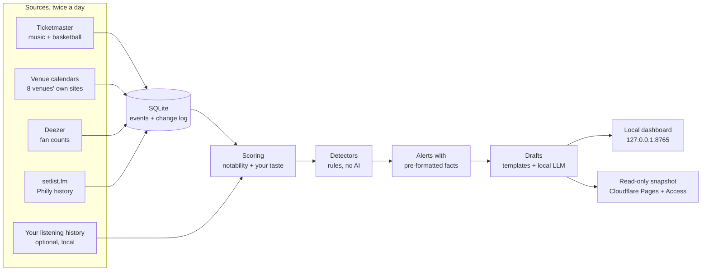

# Philly Events Tracker

A local content assistant for a Philadelphia events TikTok page. It keeps track of what's coming up in the
Philly area (concerts first, plus Sixers home games), notices when something is worth a video (a new show
announced, a presale about to open, a stacked month for a genre, a big weekend), and drafts the hook,
voiceover script, on-screen text, caption and hashtags for you to review.

**It's an assistant, not an autopilot: nothing is ever posted automatically.** You review every draft in a
small dashboard, edit what you like, copy it out and film.

It runs on a modest Windows mini PC (Intel N95, CPU only) next to other services, with a small local LLM.
The original brief is in [event-tracker-pipeline.md](event-tracker-pipeline.md).

> Working on this codebase with an AI agent? Start with [docs/agent-notes/](docs/agent-notes/README.md):
> current status, decisions and why, and the mistakes already made.

---

## What it finds

| Alert | When it fires | Draft written by |
|---|---|---|
| **Just announced** | A notable artist gets a new Philly-area date (or any new date for an artist in your rotation) | LLM |
| **Presale / on-sale** | A presale or general on-sale opens within 72 hours. One alert per artist, listing every sale window | Template + LLM hook |
| **Back after N years** | Added to the two above when setlist.fm says the artist's last Philly show was 3+ years ago | Template / LLM |
| **This weekend** | From Wednesday on: the best Fri–Sun shows, mixed across genres | LLM |
| **Stacked month** | 5+ notable shows in one genre this month (until the 15th) or next | LLM |
| **Status change** | A notable show is cancelled, postponed, rescheduled or moved | Template + LLM hook |
| **Home games this week** | Sixers home games for the week, once per week | Template + LLM hook |
| **Big game** | A marquee opponent visits within 7 days | Template + LLM hook |

"Template" means Python writes the script and caption straight from the data, so dates, times and venues are
right by construction; the model only writes the hook. That's used for the formats where a small model kept
mixing up facts (e.g. pairing a show date with a presale time).

## How it works



The core rule: **the AI writes, it never fetches or decides facts.** APIs and venue pages provide the data,
plain rules decide what's worth a video, and the model only turns a small JSON of facts into words.

### Data sources

| Source | Used for | Access |
|---|---|---|
| [Ticketmaster Discovery API](https://developer.ticketmaster.com/) | Concerts within 30 mi of City Hall (240 days ahead), Sixers home games, presale windows, genres | Free key, ~4 calls per run |
| Venue websites | Shows at rooms that sell through Tixr, DICE or Etix (Underground Arts, MilkBoy, Ardmore Music Hall, Warehouse on Watts, The Ave, Johnny Brenda's, Kung Fu Necktie, PhilaMOCA) | Public pages; robots.txt checked; one request per venue per run |
| [Deezer](https://developers.deezer.com/api) | Artist popularity (fan counts) | Public, no key |
| [setlist.fm](https://api.setlist.fm/docs/1.0/index.html) | When an artist last played the Philly area | Free key, non-commercial use, credited in captions |
| Your listening history (optional) | Boosts artists you play and your genre lane | A local SQLite file, read-only |

AXS, DICE and Tixr don't offer public APIs, so their shows come from the venues' own calendar pages instead
(most publish schema.org event data). Shows that are also on Ticketmaster are de-duplicated; Ticketmaster's
copy wins.

### Scoring

Each show gets a 0–100 notability score: headliner popularity (Deezer fans, log scale) 50%, venue size 30%,
tour size 20%. Sixers games score on the opponent and the day of the week instead. If you connect your
listening history, artists you've played in the last two years get up to +20 and your genre lane +5, and
artists you play a lot always get new-show and presale alerts, whatever their size.

## Keeping facts correct

- The model only sees the alert's facts, already formatted the way a person would say them
  ("Sat, Oct 24", "8:00 PM"). It never does date math.
- **On-screen text is built in Python** from the facts, never by the model.
- For presales, status changes and Sixers alerts, the **script and caption are templates** too.
- `check_facts` flags any date, time, price, number, weekday+date pair, presale-code lookalike or leftover
  `[placeholder]` in the model's text that isn't in the facts. Flagged drafts are retried once; templated
  formats fall back to a template hook. Remaining flags show as a ⚠ on the draft.
- Crowd-sourced history ("first Philly show since 2019") carries a "verify" note, and an artist with no
  recorded Philly show is never called a first-timer. If their last Philly show was a festival or radio
  show, the draft says so ("last time was a 9-act lineup").

It's a tripwire, not a proof: read the script before you film.

---

## Setup

### Requirements

- Windows 10/11 (the scheduling scripts use Task Scheduler; the pipeline itself is plain Python)
- Python 3.13, Node.js 20+
- [Ollama](https://ollama.com/) with `qwen2.5:3b` (~2 GB; about a minute per draft on a CPU-only N95)
- A Ticketmaster Discovery API key. Optional: setlist.fm API key, Cloudflare account

### Install

```powershell
git clone https://github.com/bryanygan/event-tracker.git
cd event-tracker
python -m venv .venv
.venv\Scripts\pip install -r requirements.txt
copy .env.example .env          # then fill it in (see below)
ollama pull qwen2.5:3b
cd dashboard
npm install
npm run build                   # the local dashboard
npm run build:static            # the read-only snapshot (only if you use Cloudflare Pages)
cd ..
.venv\Scripts\python -m pytest -q
```

### Configuration (`.env`)

| Variable | Required | What it's for |
|---|---|---|
| `TICKETMASTER_CONSUMER_KEY` | yes | Discovery API key (the "consumer key"; the secret isn't used) |
| `TICKETMASTER_CONSUMER_SECRET` | no | Kept for possible future use |
| `SETLISTFM_API_KEY` | no | "First Philly show since …" history |
| `LISTENING_DB` | no | Path to a play-history SQLite file for the taste boost (see below) |
| `CLOUDFLARE_API_TOKEN`, `CLOUDFLARE_ACCOUNT_ID`, `PAGES_PROJECT` | no | Read-only web snapshot |
| `OLLAMA_URL`, `OLLAMA_MODEL`, `DASHBOARD_PORT` | no | Defaults: `http://127.0.0.1:11434`, `qwen2.5:3b`, `8765` |
| `SPOTIFY_CLIENT_ID`, `SPOTIFY_CLIENT_SECRET` | no | Currently unused (Spotify no longer returns popularity or genres to development-mode apps) |

Never commit `.env`; it's gitignored.

Everything else (search radius, thresholds, venue list and sizes, junk filters, teams, niche genres) lives in
[`tracker/config.py`](tracker/config.py), with comments.

**Listening history format.** `LISTENING_DB` points at a SQLite file with a `plays(artist, played_at)` table
and, optionally, `artist_genres(artist_key, primary_bucket)` for genre buckets. It's opened read-only, and
nothing from it is copied into the repo or shown to the model; it only changes scores and dashboard badges.

### Scheduling

```powershell
powershell -ExecutionPolicy Bypass -File scripts\install_tasks.ps1
```

This registers two tasks for the current user, both windowless and at below-normal priority:

- **PhillyEvents-Pipeline**: 6:30 AM and 4:30 PM daily. Presales usually open at 10 AM, so a 72-hour window
  gives at least a day's notice.
- **PhillyEvents-Dashboard**: starts the dashboard at logon and restarts it if it crashes.

Remove them with `scripts\uninstall_tasks.ps1`. Note that the tasks run whatever branch is checked out.

---

## Daily use

| Do this | How |
|---|---|
| Review drafts | Open http://127.0.0.1:8765 → **Alerts & drafts** |
| Browse upcoming shows | **Events** tab (search, genre filter, 🎧 "artists I listen to") |
| Run the pipeline now | **Run pipeline now** button, or `.venv\Scripts\python -m tracker.run` |
| Data and alerts only, no LLM | `.venv\Scripts\python -m tracker.run --no-drafts` |
| Replay the last Ticketmaster pull (no API calls) | `.venv\Scripts\python -m tracker.run --from-cache` |
| Push a fresh web snapshot | **Publish snapshot** button, or `.venv\Scripts\python -m tracker.publish` |
| Dashboard with hot reload | `cd dashboard; npm run dev` → http://127.0.0.1:5173 |
| Logs | `logs\pipeline.log` |

**Review flow:** open an alert, expand **Facts** if something looks off, edit the draft in place, copy the
hook, script, on-screen text and caption, and set the status (pending → approved → filmed). **New draft**
asks the model again (about a minute). A ⚠ means the fact checker wants you to look closer.

## Web snapshot (optional)

A read-only copy of the dashboard can be published to Cloudflare Pages after every run, so you can review
drafts on your phone. Edits still happen on the local dashboard.

1. Create a Cloudflare API token with **Cloudflare Pages: Edit** and **Access: Apps and Policies: Edit**, and
   set `CLOUDFLARE_API_TOKEN`, `CLOUDFLARE_ACCOUNT_ID` and `PAGES_PROJECT` in `.env`.
2. Set up Cloudflare Zero Trust (the free plan is enough), create the Pages project, and lock it with an
   existing reusable Access policy:
   `.venv\Scripts\python -m tracker.publish --setup-access "<policy name>"`
3. Check it's locked: `.venv\Scripts\python -m tracker.publish --check`

**Publishing refuses to upload unless both the site and its per-deployment URLs redirect to the Cloudflare
Access login.** The snapshot also sends `noindex` headers. (A brand-new project has no hostname until its first
deploy, so deploy an empty placeholder page first, then check, then publish.)

## Project layout

```
tracker/
  config.py            all tunables, with comments
  run.py               the pipeline (what the scheduler runs)
  fetchers/
    ticketmaster.py    Discovery API: window splitting, call budget, name cleanup
    venue_calendars.py venue pages: JSON-LD reader + HTML parsers, Ticketmaster dedupe
    deezer.py          artist popularity
    setlistfm.py       last Philly-area show, lineup size
  store.py             SQLite upserts and the change log (new / price / status / date / presale / removed)
  scoring.py           notability score + taste boost
  listening.py         optional listening-history signal (read-only)
  detectors.py         rules that turn data into alerts
  templates.py         template scripts, captions, hooks, hashtags
  llm.py               Ollama prompts, on-demand start/stop, fact checker
  drafts.py            draft generation, retries and fallbacks
  api.py               FastAPI backend for the dashboard (localhost only)
  publish.py           Cloudflare Pages snapshot + Access guardrail
dashboard/             React + TypeScript (Vite); `build` = local app, `build:static` = snapshot
scripts/               Task Scheduler install/uninstall
tests/                 pytest suite, no network (all external services mocked)
docs/agent-notes/      handoff notes: status, decisions, gotchas, environment, worklog, venue coverage
```

## Testing

```powershell
.venv\Scripts\python -m pytest -q
```

The suite never touches the network or real accounts: HTTP is mocked, and `tests/conftest.py` blanks every
key, the venue list, the Cloudflare settings and the listening-history path.

## Design notes

- **Runs alongside other services.** The dashboard binds to 127.0.0.1 only. Ollama is started just for
  drafting and fully stopped afterwards (including its model runner process), so the ~2 GB model isn't held in
  RAM all day. Tasks run at below-normal priority.
- **First reads are baselines.** The first Ticketmaster run, and the first read of each new venue, store
  everything without calling it "new", so day one doesn't flood you with "just announced".
- **A broken source can't wipe data.** If a venue page fails or changes shape, its existing shows are kept and
  the dashboard shows a warning.
- **Small venues mostly stay quiet.** Their shows appear in the Events tab and weekend roundups, but only
  raise their own alerts when the artist is notable, coming back after years, or someone you listen to.

The full reasoning, including what was tried and rejected, is in
[docs/agent-notes/decisions.md](docs/agent-notes/decisions.md).

## Not done yet

- Food, festivals and other things to do (no clean APIs; would need scrapers)
- More teams: add a Ticketmaster attraction name to `SPORTS_TEAMS` (the basketball feed already includes
  Villanova and NCAA events)
- An "under $40 this month" format (only ~15% of Ticketmaster events include prices)
- Phone notifications for big presales (on hold until the pipeline has run cleanly for a while)
- Slideshow / image generation from the on-screen text

## Credits

Event data from Ticketmaster and the venues' own websites; popularity from Deezer; concert history from
[setlist.fm](https://www.setlist.fm/). Drafts are written locally with [Ollama](https://ollama.com/) and
[Qwen2.5](https://github.com/QwenLM/Qwen2.5).
